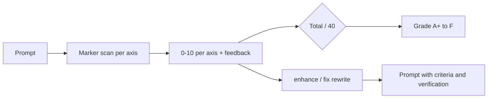

# rig-ai-engineering

[](https://github.com/mrodgersjs-web/rig-ai-engineering/actions/workflows/ci.yml)
[](LICENSE)
[](https://www.python.org/)

Scores a prompt on four axes and rewrites the weak ones, offline and deterministic. Built for anyone who sends prompts to coding agents and wants a check before the run starts.

## Why this exists

Most prompts fail the same way: vague, no context, no definition of done. This tool grades a prompt on Specificity, Doctrine, Context and Actionability (0-10 each, out of 40) with plain regex heuristics, so the score is offline, deterministic and free. Weak prompts come back rewritten with acceptance criteria and a stage coordinate.

## Quickstart

```bash
python3 -m pip install -e '.[dev]'
rig-ai score -f examples/calibration/solid.txt
```

## Usage

`examples/calibration/solid.txt` is a real prompt:

```text
Refactor src/auth.py to use bcrypt for password hashing. Keep the existing test suite in tests/test_auth.py passing and add a test for the new hash format.
```

The command above prints this, exactly:

```text
RIG Prompt Score: 18/40 (D)

  Specificity     6/10 - Moderate specificity (output_format, verification). Add file paths, line numbers, or exact output format.
  Doctrine        0/10 - Add RIG doctrine: success criteria, scope boundaries, verification steps, or a lattice coordinate (e.g., D1, L7).
  Context         3/10 - Missing context. Reference files (#file:), skills, prior work, or project state so the agent can ground its answer.
  Actionability   9/10 - Highly actionable (action_verbs, directives).
```

Three calibration prompts in `examples/calibration/` show the ladder. Their scores are pinned by the test suite (`expected.json`):

| Prompt | Total | Grade |
| --- | --- | --- |
| weak.txt | 2 | F |
| solid.txt | 18 | D |
| strong.txt | 38 | A+ |

Other commands:

```bash
rig-ai axes                       # the rubric: what each axis measures
rig-ai enhance -p "fix the bug"   # rewrite with acceptance criteria
rig-ai fix -p "hi, can you just fix it?"
rig-ai suggest "write unit tests" # matching templates
rig-ai doctor                     # engine health check
```

## How it works



Definitions for every axis, marker and grade band live in `rig_ai/axes.py` and [docs/axes.md](docs/axes.md). Scoring uses regexes and word counts only: no model, no network, same score on every run.

## What it proves

Checks a reader can run:

- `rig-ai score -f examples/calibration/solid.txt` prints `18/40 (D)` with the four axis lines above.
- `pytest -q` passes, including tests that pin the calibration scores and the README's quoted output.
- `rig-ai doctor` prints `Status: HEALTHY` and exits 0.
- `ruff check .` is clean.

## Project layout

```text
rig_ai/prompt_engine.py   scorer, enhancer, fixer, template matching
rig_ai/axes.py            axis definitions and grade bands (source of truth)
rig_ai/templates.py       20 prompt templates
rig_ai/cli.py             the rig-ai command
examples/calibration/     weak, solid and strong prompts with expected scores
test/                     pytest suite
docs/axes.md              rubric reference
```

## Development

```bash
python3 -m pip install -e '.[dev]'
pytest -q --cov=rig_ai
ruff check .
```

## Contributing

See [CONTRIBUTING.md](CONTRIBUTING.md).

## Security

See [SECURITY.md](SECURITY.md). Report issues to security@rodgersintelligence.com.

## License

MIT. See [LICENSE](LICENSE).

---

Built by Mike Rodgers · rodgersintelligence.com
